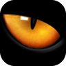
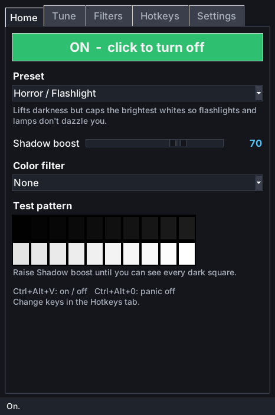
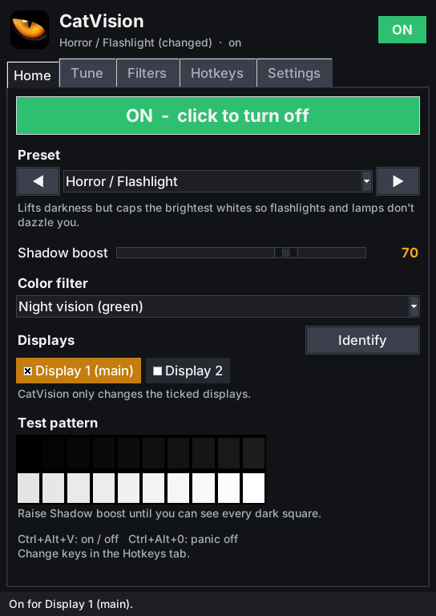
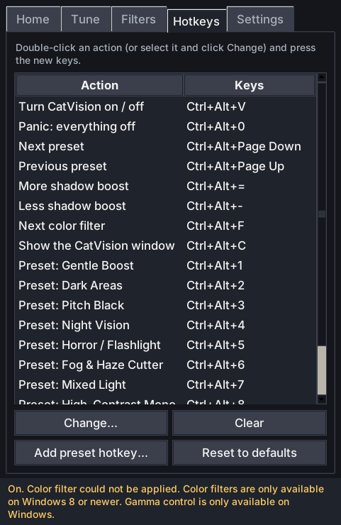
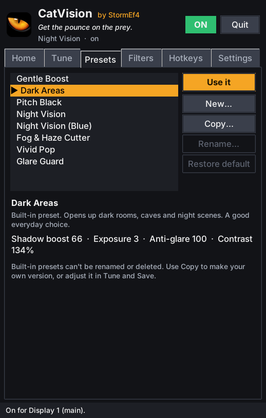
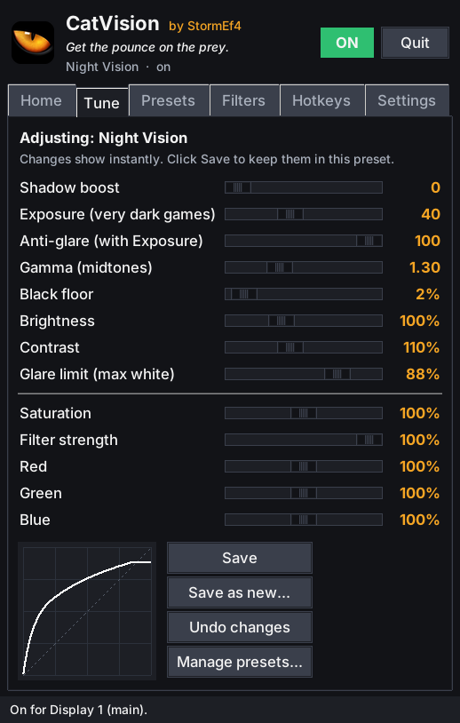
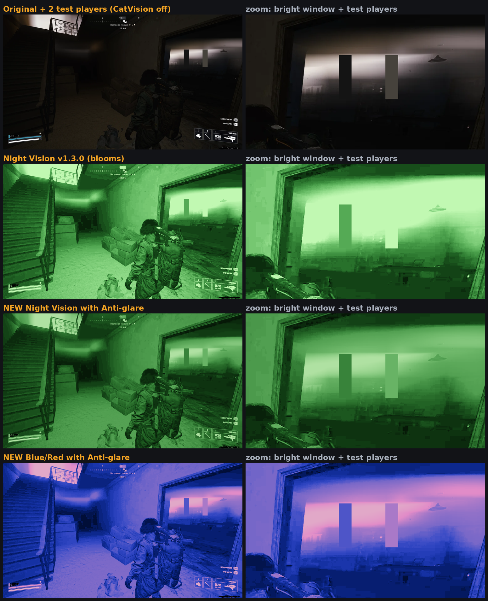
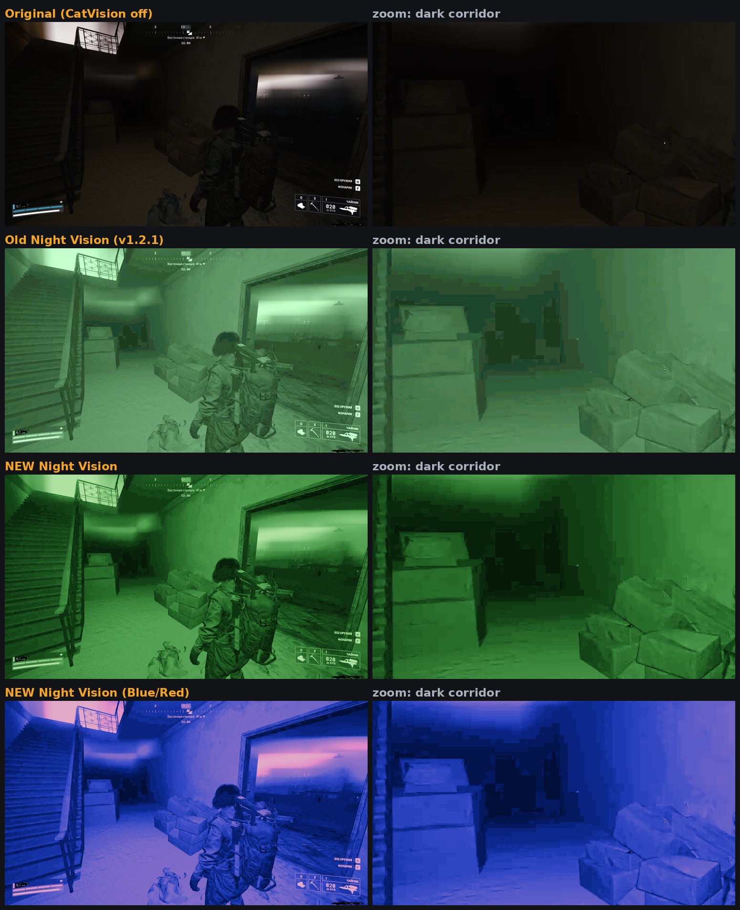
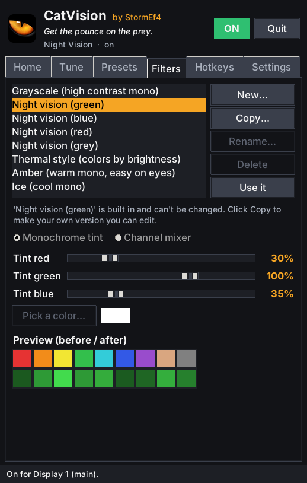

# CatVision

 

**See in the dark, in any game.** CatVision is a small accessibility app for
Windows that brightens dark areas of your screen so caves, night scenes and
horror games are easier to see. It has presets for different situations, its
own color filters, and hotkeys that work while you play. You can change all
of these.

## Download

**[⬇ Download CatVision.exe](https://github.com/StormEf4/CatVision/releases/latest/download/CatVision.exe)**
(from the [Releases page](https://github.com/StormEf4/CatVision/releases))

It's one file. Nothing to install and no Python needed. Put it anywhere,
for example on your desktop, and double-click it.

> **"Windows protected your PC"?** That's normal for small apps that haven't
> paid for a code-signing certificate. Click **More info**, then
> **Run anyway**. You only need to do this once.

## Is it safe? Will it get me banned?

CatVision **never touches your games**:

- It does **not** inject anything, read or write game memory, hook DirectX or
  OpenGL, or attach to any process.
- It does **not** draw an overlay on the game. It doesn't look at your screen
  either, unless you turn on **Auto levels (beta)**, which only measures how
  bright the picture is (see [Auto levels](#auto-levels-beta)).
- It does **not** use keyboard hooks. Hotkeys use the normal Windows
  `RegisterHotKey` feature, the same one Discord and OBS use.

It only uses two standard Windows display features:

1. **The graphics card's brightness table** (gamma ramp). NVIDIA/AMD control
   panels, f.lux and monitor-calibration tools all change this. Your
   monitor's own "black stabilizer" setting does the same job inside the
   monitor.
2. **Windows' accessibility color filters**, the same engine as
   *Settings → Accessibility → Color filters*.

From the game's point of view nothing has changed. The change only happens
on the way to your monitor, like turning your monitor's brightness up.

> One honest caveat: organized tournaments and LAN events sometimes ban *all*
> outside software. Check their rules if you play in one. Normal online play
> is fine: anti-cheat systems don't look at display brightness.

## Using it

The window is small and split into tabs:

| Tab | What's there |
| --- | --- |
| **Home** | Preset picker (◀ ▶ to flip through), **Shadow boost** and **Exposure**, color filter, which **displays** to change, and **Auto levels (beta)** |
| **Tune** | Every slider, and a big **Test pattern** to tune against. **Save** keeps your changes in the current preset (built-in ones too), **Save as new...** makes your own preset |
| **Presets** | Every preset in one list: **Use it**, **New...** (from your current settings), **Copy...**, **Rename...**, **Delete** |
| **Filters** | Make and edit your own color filters |
| **Hotkeys** | Set a hotkey for any action, and an on/off hotkey for every preset |
| **Settings** | Start with Windows, tray icon, text size, full strength, reset display |

The header shows the ON/OFF switch and a **Quit** button (quitting always puts
your screen back to normal). When something needs your attention, a **⚠**
appears next to them: click it to see what's wrong, what to do, and buttons
that fix it. Click it again to close it; it also closes by itself once the
problem is fixed.

**Quick start:** pick **Dark Areas**, click **OFF** so it turns green, then
open **Test pattern...** in the Tune tab and move **Shadow boost** until the
dark squares are all visible. Leave the pattern open while you adjust; it has
a **Full screen** button (or press F11) for an even bigger picture. Not sure what something does? Rest the mouse on it for a short
explanation.

## Choosing displays (multiple monitors)

With two or more monitors, the Home tab shows a checkbox for each display:
🖥️ and its number, with ⭐ on your main display (rest the mouse on one for its
full name). CatVision only changes the **ticked** displays, so you can brighten the
game monitor and leave the one with Discord or a browser alone. **Identify**
shows each display's name on that screen so you know which is which.

- **Brightness, Shadow boost, contrast, glare limit and tints** only change
  the ticked displays.
- **Tint filters** (Night vision, Amber, Ice and your own *Monochrome tint*
  filters) also stay on the ticked displays. There they show as a colored
  tint rather than full monochrome.
- **Unticked displays are never changed.** Saturation and color-mixing
  filters (Grayscale and your own *Channel mixer* filters) can only be
  applied by Windows to **every display at once**, so while only some
  displays are ticked they're left off. The ⚠ tells you when that happens,
  with a **Use it anyway** button if you want them on every display.

## The tray icon (by the clock)

Closing the window keeps CatVision running in the **system tray**, so your
hotkeys keep working. Click the cat-eye icon to open the window, or
right-click it for quick controls:

- **CatVision on**: turn it on or off
- **Auto levels (beta)** and **keep this look**
- **Preset**, **Color filter**, **Shadow boost** (+10 / -10), **Displays**
- **Panic: everything off** and **Reset display to normal**
- **Quit CatVision**: closes normally and saves your settings
- **Force quit**: closes immediately, even if the window has frozen. Your
  screen is put back to normal first.

You can make the close button quit instead in Settings.

## Hotkeys (work while you're in a game)

CatVision starts with **no hotkeys**, so it never takes a key you use for
something else. Set the ones you want in the **Hotkeys** tab: double-click an
action and press the keys.

| Action | What it does |
| --- | --- |
| Turn CatVision on / off | On or off with the current preset |
| **On/off: (any preset)** | Every preset has one: turns that preset on, press again to turn it off |
| Next / previous preset | Flip through presets |
| More / less boost | Shadow boost, or Exposure for night vision |
| Next color filter | Cycle color filters |
| Auto levels on / off (beta) | Turns [auto levels](#auto-levels-beta) on or off |
| Auto levels: keep this look (beta) | Auto levels aims for how the game looks right now |
| Show the CatVision window | Brings the window up |
| Panic: everything off | Everything back to normal |

Want a ready-made set? **Use suggested keys** fills in Ctrl+Alt+V for on/off,
Ctrl+Alt+1-8 for the eight presets, Ctrl+Alt+0 for panic and a few more. **Clear
all** removes them again. Everything is also in the tray menu.

- Every built-in preset has its own on/off row. **Add preset hotkey...** gives
  your own presets one too.
- CatVision won't let you pick a plain letter key like `Q`, because that key
  would stop working in your games. Use Ctrl or Alt with it, or an F-key.
- If another program already uses a key combination, the list marks it
  *"taken by another app"*. Pick a different one.
- A small popup confirms each hotkey at the top of every ticked display. It
  can't be clicked and never takes focus away from your game, and you can
  turn it off in Settings.

 

## Auto levels (beta)

**Beta: new and still being tested.** Tick **Adjust to the game
automatically** under *Auto levels* on the Home tab (or use its hotkey or the
tray menu). CatVision then watches how bright the picture is on each ticked
display and adjusts it live, the way your eyes adapt:

- **Dark scene:** it raises Shadow boost (or Exposure for night vision)
  gradually, so the picture doesn't jump.
- **Bright scene, flash or explosion:** it lowers it again quickly, so you're
  never blinded.
- Your preset stays as it is. Auto levels moves things up or down from your
  preset, and goes back to it when you turn auto levels off.
- It looks mostly at the **middle of the screen**, where you're looking, so
  the HUD and screen edges don't throw it off. It also pays extra attention
  to **dark patches**, so a dark doorway still gets help when the sky is
  bright.
- Changes **fade smoothly** (20 small steps a second), it ignores tiny
  changes so the picture doesn't keep "breathing", and it catches up faster
  after a big change (stepping from daylight into a dark building).
- **Flash guard:** a sudden flash or explosion is toned down at once.
- **No pumping:** it only brightens once a scene has stayed dark for a
  moment, so flickering lights, muzzle flashes and lightning don't make the
  picture bounce.
- **Keep this look:** when the game looks just right, click **Keep this look**
  (or use its hotkey or the tray menu). Auto levels then aims for that look,
  and brighter or darker scenes are adjusted from there.
- **Each game remembers its own look.** A look you keep while a full-screen
  game is in front is saved for that game (recognized by its window title)
  and used again automatically next time. The Home tab shows *Game: ...* and
  **Aim for** shows and changes that game's look; **Forget** goes back to the
  normal Aim for.
- **Never runs out of room:** if your preset's Shadow boost is already high
  (Pitch Black is 85), the extra brightening that doesn't fit goes into
  Exposure instead, and the same when dimming.
- **How much** sets how far it may move the slider. **Aim for** sets how
  bright it tries to make scenes: higher brightens dark scenes more.
- **Speed**: Slow, Normal or Fast reaction to darker and brighter scenes.
  Flashes are always toned down quickly.
- **Only while a game fills the screen** (on by default): on the desktop or in
  a windowed app it pauses and eases back to your preset. Games in fullscreen
  or borderless windowed mode count, and so do full-screen videos. Only the
  position and title of the window in front are checked, nothing inside it.
- **Also tone down bright scenes** (on by default): untick it if you only
  ever want it to brighten.
- Each ticked display is adjusted on its own, and the Home tab shows what it
  is doing (for example *Display 1: 3% bright · Shadow boost 66 → 88*).

**How it stays safe:** five times a second it takes a tiny, low-resolution
copy of what Windows is already showing (the same screen-capture route
recording and streaming apps use) and measures only how bright it is. It
never touches the game, never saves or sends the pictures, and never looks
for anything in them. It only changes brightness, nothing that would point
things out to you.

**Things to know:**

- It works best with games in **borderless windowed** mode. Some games in
  exclusive fullscreen can't be seen; the Home tab then says *can't see the
  picture* and auto levels leaves your preset alone.
- A few games and videos block screen capture and show up black. Auto levels
  holds still on a black screen instead of over-brightening, and if it can't
  see the picture at all for a couple of seconds it eases back to your preset.
- It's off by default, and it stops watching whenever CatVision or auto
  levels is turned off.

## Presets

| Preset | Good for |
| --- | --- |
| Gentle Boost | Games that are just a little too dark |
| Dark Areas | Everyday choice: dark rooms, caves, night |
| Pitch Black | Nearly black areas (looks washed out, but you'll see) |
| Night Vision | Like night-vision goggles: deep green shadows, pale highlights, no blinding bloom |
| Night Vision (Blue) | Night vision in cool blue, with the same anti-glare protection |
| Fog & Haze Cutter | Murky, foggy, smoky scenes |
| Vivid Pop | Richer colors and contrast |
| Glare Guard | Bright snow and desert scenes |

More looks are in the **Color filter** list (Night vision red and grey,
Thermal style, Grayscale, Amber, Ice); pick one and **Save as new...** to make
it a preset.

 

**Changing presets:** pick one, adjust the sliders in **Tune**, and click
**Save**. An edited built-in preset shows *(edited)*; **Restore default** in
the **Presets** tab puts it back. Create, copy, rename and delete your own
presets in the **Presets** tab.

 

### What the sliders do

- **Shadow boost**: the main control. It brightens dark parts a lot and
  bright parts barely at all, so the sky doesn't turn white.
- **Exposure**: for games where the *whole* scene is very dark. It amplifies
  dim light evenly, like night-vision goggles, so shapes keep their depth
  instead of looking foggy.
- **Anti-glare** (with Exposure): stops bright lights from blooming, so lamps
  and windows never hide a player standing in front of them.
- **Gamma (midtones)**: brightens or darkens the middle tones.
- **Black floor**: raises pure black to dark grey.
- **Brightness / Contrast**: as usual.
- **Glare limit**: caps the brightest whites. Useful for flashbangs and
  flashlights.
- **Saturation / Filter strength / Red-Green-Blue**: color strength, how
  strongly the color filter applies, and an overall tint.

## Night vision

Tuned on dark in-game screenshots. Both night-vision presets use three
settings together:

- **Exposure** spreads a very dark scene's tones across the whole brightness
  range, so shapes keep their depth instead of looking foggy. The color is
  added *after* brightening, like the phosphor screen in real goggles.
- **Anti-glare** keeps bright lights from blooming. Instead of every bright
  thing turning the same white, bright areas get their own range, so a lamp
  or window stays brighter than anyone standing in front of it.
- **Glare limit** caps the brightest output, so night vision never blinds you.

On the reference screenshot, with two test players placed in front of a lit
window: before Anti-glare, the mid-tone player was *brighter* than the window
and disappeared into the glow. Now both players stand out clearly, bright
areas keep their detail, and the brightest output is capped at 80%. Night
Vision shows about 3x the game's own dark-area detail.

- Raise **Exposure** (or use your *More boost* hotkey) for very dark games,
  lower it for brighter ones. In **Tune**, raise **Anti-glare** if bright
  areas still hide things, or lower it to see more in the darkest corners.
- Green shows the most detail, because our eyes see fine detail best in green.
  Blue is tuned to stay as readable as possible (pure blue would be too dark).
- The **Thermal style** color filter looks like a thermal camera, but it colors the picture by
  *brightness*, not heat: dark things look "cold", bright things look "hot".
  Real heat vision would mean reading the game's data, which is exactly what
  anti-cheat systems watch for and what CatVision never does, so it stays a
  display-only effect like everything else.
- With only some displays ticked, night vision stays on those displays, but
  as a colored tint rather than full monochrome (Windows limit).

## Making your own color filters

In the **Filters** tab, click **New...** (or select a built-in filter and
click **Copy...** to start from it). There are two kinds:

- **Monochrome tint**: the picture turns grayscale and is tinted one color,
  like the built-in Night vision and Amber. Use the sliders or
  **Pick a color...**.
- **Channel mixer**: full control. Each output color is a mix of the input
  colors. For example, *Red out = 1.0 × Red* is normal, and moving some of
  Red into Green shifts reds toward yellow.

Your filter is used straight away so you can see changes live (turn
CatVision on first), and the preview shows colors before and after. Your
filters appear in the **Color filter** list on the Home tab, can be saved
into any preset, and can be cycled with the *Next color filter* hotkey.

 

## Get the full strength

By default Windows only lets apps change brightness a limited amount, which
weakens strong looks like night vision. When that happens, the ⚠ in the
header says *"Windows is holding back the strength of this look"* and has an
**Unlock full strength...** button.

1. Click **Unlock full strength...** and confirm. Windows asks for permission.
2. Restart your PC.

This changes one documented Windows setting (`GdiIcmGammaRange`), the same
one display-calibration software uses. **Settings → Full strength** shows
whether it's unlocked and has an **Undo** button. If the ⚠ still says so
after the restart, it tells you your graphics driver has its own limit, and
CatVision is already as strong as your PC allows.

(Running from source instead? `windows/enable_full_strength.reg` and
`windows/undo_full_strength.reg` do the same thing.)

## Tips and troubleshooting

When something needs your attention, a **⚠** appears in the header. Click it
for what's wrong, what to do, and a button that does it (for example **Use it
anyway** when a color effect can only cover every display). The line at the
bottom of the window just says what CatVision is doing.

- **Game in exclusive fullscreen and the color filter doesn't show?**
  Brightness works in every mode, but color filters need **Borderless** or
  **Windowed fullscreen**.
- **The effect disappears when a game starts.** Some games reset brightness
  on launch. Leave *Keep applied* on (Settings) and CatVision puts it back
  within about 2 seconds.
- **Nothing happens with HDR on.** Windows ignores brightness tables while
  HDR is on. Turn HDR off in *Settings → Display* while you use CatVision.
- **Windows' own Color filters are on.** Turn them off; they conflict with
  CatVision's color filters.
- **Screen stuck bright or dark?** Quitting CatVision always restores it. If
  it crashed, just start it again; it notices and cleans up. You can also use
  **Reset display now** in Settings, **Reset display to normal** or
  **Force quit** in the tray menu, your *Panic* hotkey if you set one, or run
  `CatVision.exe --reset`.
- **Text too small?** Settings → Text size → *Extra large*.
- **Opened CatVision twice?** The second copy just brings up the first one's
  window.

Your settings, presets, filters and hotkeys are saved in
`%APPDATA%\CatVision\config.json` (Settings → *Open settings folder*).

## For developers

The `.exe` is built automatically by GitHub Actions
(`.github/workflows/build.yml`) on a Windows machine. Each build runs the unit
tests, then a self-test (`CatVision.exe --selftest report.json`) against the
real Windows display, color-filter, hotkey and tray APIs, both from source and
on the built exe, then publishes the exe to the
[Releases page](https://github.com/StormEf4/CatVision/releases). To build it
yourself on Windows, run `build_exe.bat`.

To run from source: Python 3.9+, `pip install pystray pillow` (optional, for
the tray icon), then `python run_catvision.py` (or `CatVision.bat`).

- `catvision/curves.py`: brightness curve and color-matrix math
- `catvision/filters.py`: user color filters
- `catvision/backends.py`: the two Windows display APIs (plus no-op versions)
- `catvision/engine.py`: applies settings and always knows how to undo them
- `catvision/hotkeys.py`: hotkey parsing and the `RegisterHotKey` listener
- `catvision/gui*.py`, `theme.py`, `tray.py`: the window, tabs and tray icon

Run the tests with `python -m unittest -v`.
