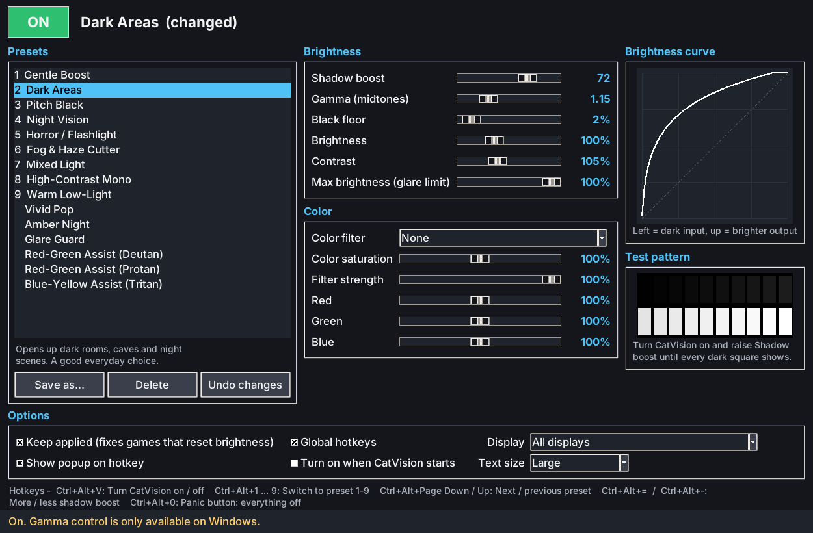

# CatVision

**See in the dark, in any game.** CatVision is a small accessibility tool for
Windows that brightens dark areas on your screen so shadows, caves, night
scenes and horror games are easier to see. It has quick presets for different
situations, and you can switch between them with hotkeys while you play.



## Is it safe? Will it get me banned?

CatVision **never touches your games**:

- It does **not** inject anything, read or write game memory, hook DirectX or
  OpenGL, or attach to any process.
- It does **not** draw an overlay on top of the game or capture your screen.
- It does **not** use keyboard hooks. Hotkeys use the normal Windows
  `RegisterHotKey` feature, the same one Discord and OBS use.

It only uses two standard Windows display features:

1. **The graphics card's gamma ramp** (`SetDeviceGammaRamp`). This is the
   brightness lookup table your GPU applies to the whole screen just before
   sending it to the monitor. NVIDIA/AMD control panels, f.lux and
   monitor-calibration tools all use it. Your monitor's own "black
   stabilizer" or "shadow boost" setting does the same job inside the monitor.
2. **Windows' accessibility color filters** (`MagSetFullscreenColorEffect`).
   This is the same engine as *Settings → Accessibility → Color filters*. It is
   only used for the color looks (night vision, grayscale, color-blind
   assist).

From the game's point of view nothing has changed. The change only happens
on the way to your monitor, as if you had turned your monitor's brightness up.

> One honest caveat: organized tournaments and LAN events sometimes ban *all*
> outside software or display tweaks. Check their rules if you play in one.
> Normal online play is fine: anti-cheat systems don't look at display gamma.

## Getting started

1. Install **Python 3.9 or newer** from https://www.python.org/downloads/.
   During setup, tick **"Add python.exe to PATH"**. Nothing else is needed.
2. Download this folder.
3. Double-click **`CatVision.bat`**.
4. Pick a preset on the left (try **Dark Areas**) and click **OFF** at the
   top so it turns green and says **ON**.

Optional: run `build_exe.bat` once (after `pip install pyinstaller`) to get a
single `CatVision.exe` in the `dist` folder.

### Get the full strength (recommended)

By default Windows only lets programs change brightness curves a limited
amount. CatVision still works within that limit. If the status bar says
*"Windows limited the strength"*, you can lift the limit:

1. Double-click **`windows/enable_full_strength.reg`** and click *Yes*.
2. Sign out and back in (or restart).

This sets one documented registry value (`GdiIcmGammaRange`), the same one
display-calibration software uses. To undo it, run
`windows/undo_full_strength.reg`.

## Hotkeys (work while you're in a game)

| Keys | What it does |
| --- | --- |
| **Ctrl+Alt+V** | Turn CatVision on / off |
| **Ctrl+Alt+1 … 9** | Jump to preset 1-9 (the numbers in the list) |
| **Ctrl+Alt+Page Down / Page Up** | Next / previous preset |
| **Ctrl+Alt+=** / **Ctrl+Alt+-** | More / less shadow boost |
| **Ctrl+Alt+0** | Panic button: everything back to normal |

A small popup at the top of the screen confirms each hotkey. You can't click
it and it never takes focus away from your game. You can turn it off in
Options.

## Presets

| # | Preset | Good for |
| --- | --- | --- |
| 1 | Gentle Boost | Games that are just a little too dark |
| 2 | Dark Areas | Everyday choice: dark rooms, caves, night |
| 3 | Pitch Black | Nearly black areas (looks washed out, but you'll see) |
| 4 | Night Vision | Green night-vision look with a strong lift |
| 5 | Horror / Flashlight | Lifts darkness, stops flashlights and lamps from dazzling |
| 6 | Fog & Haze Cutter | Murky, foggy, smoky scenes |
| 7 | Mixed Light | Dark shadows next to bright skies or explosions |
| 8 | High-Contrast Mono | Grayscale: shapes and edges stand out |
| 9 | Warm Low-Light | Shadow lift with less blue light for tired eyes |
| | Vivid Pop | Richer colors and contrast |
| | Amber Night | Strong lift in warm amber monochrome |
| | Glare Guard | Bright snow and desert scenes |
| | Red-Green Assist (Deutan / Protan) | Color correction for red-green color blindness |
| | Blue-Yellow Assist (Tritan) | Color correction for blue-yellow color blindness |

Change any slider to fine-tune, then **Save as...** to keep it as your own
preset. Your own presets show up in the list too, and the first nine items
in the list get the number hotkeys.

### What the sliders do

- **Shadow boost**: the main control. It brightens dark parts a lot and
  bright parts barely at all, so the sky doesn't turn white.
- **Gamma (midtones)**: brightens or darkens the middle tones.
- **Black floor**: raises pure black to dark grey, so nothing is completely
  black.
- **Brightness / Contrast**: as usual.
- **Max brightness (glare limit)**: caps the brightest whites. Useful for
  flashbangs, flashlights and snow.
- **Color filter / saturation / Red-Green-Blue**: tints and color looks.

The **test pattern** on the right shows 10 very dark squares and 10 very
bright squares. Turn CatVision on and raise *Shadow boost* until you can tell
every dark square apart.

## Tips and troubleshooting

- **Game runs in exclusive fullscreen and the color filter doesn't show?**
  Brightness changes work in every mode, but Windows color filters need
  **Borderless / Windowed fullscreen**.
- **The effect disappears when a game starts.** Some games reset brightness
  when they launch. Leave *Keep applied* ticked and CatVision puts it back
  within about 2 seconds. Lowering the game's own brightness/gamma slider to
  its default also helps.
- **Nothing happens with HDR on.** Windows ignores gamma curves while HDR is
  enabled. Turn HDR off in *Settings → Display* while you use CatVision.
- **Windows' own Color filters are on.** Turn them off; they conflict with
  CatVision's color looks.
- **My screen is stuck bright or dark.** Closing CatVision always restores the
  screen. If it crashed, start it again (it notices and cleans up), press
  **Ctrl+Alt+0**, or double-click **`Reset Display.bat`**.
- **Text is too small.** Change *Text size* in Options to *Extra large*.
- Using two monitors? Pick one under *Display*, or use *All displays*.

Settings are stored in `%APPDATA%\CatVision\config.json`.

## For developers

Pure Python standard library with no dependencies. The code is in
`catvision/`:

- `curves.py`: brightness curve and color-matrix math (platform independent)
- `backends.py`: the two Windows APIs, plus no-op versions for other systems
- `engine.py`: applies settings and always remembers how to undo them
- `hotkeys.py`: `RegisterHotKey` listener
- `gui.py`: tkinter window

Run the tests with:

```
python -m unittest -v
```

On non-Windows systems the window runs in preview mode, so you can work on
the UI there, but the display itself is not changed.
